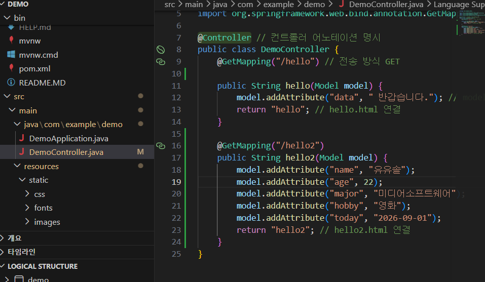
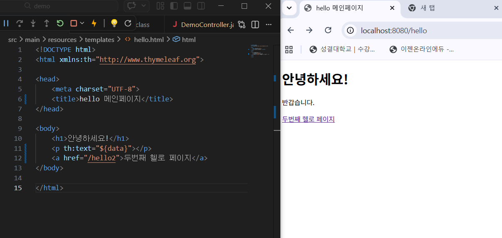
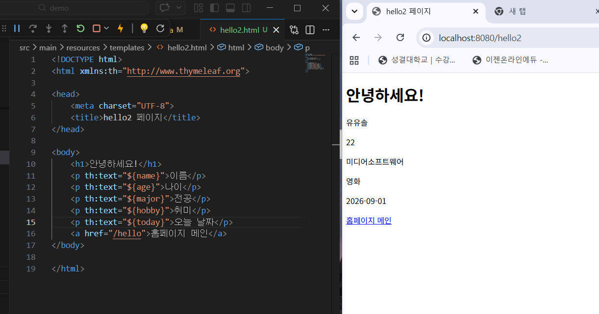

## 2주차 스프링 부트 개발환경, 테스트 완료

### 실행 내용
1. VSCode에서 스프링 부트 개발 환경 구축
2. 기본 화면 실행 (index.html 실행 및 수정 완료)

### 학습 기록
스프링을 쉽게 사용할 수 있게 해주는 스프링 부트의 기반을 다졌고, 웹 구조화 및 요청 처리 방식을 코드 실습을 통해 익힐 수 있었다.

### 실제 동작 과정
1. 내장 톰캣이 웹페이지를 실행
2. Spring IoC 컨테이너가 자바 객체(빈)들을 관리
3. 서블릿이 프론트 컨트롤러 역할을 수행
4. Thymeleaf가 서버 측에서 HTML을 렌더링하여 응답

### 연습문제 
URL 매핑과 컨트롤러 추가하기 
1. 컨트롤러에 맵핑을 추가 (hello2 메서드)

2. hello.html 링크를 수정하여 hello2.html로 이어지게 만듦 

3. hello2.html을 작성하고, Thymeleaf(`th:text`) 문법을 이용해 컨트롤러에서 전달한 5개 속성 값을 서버 렌더링 시점에 동적으로 출력하도록 구현

컨트롤러에서 뷰로 데이터를 전달하고 렌더링하는 요청 처리 흐름을 직접 실습을 통해 이해할 수 있었음.