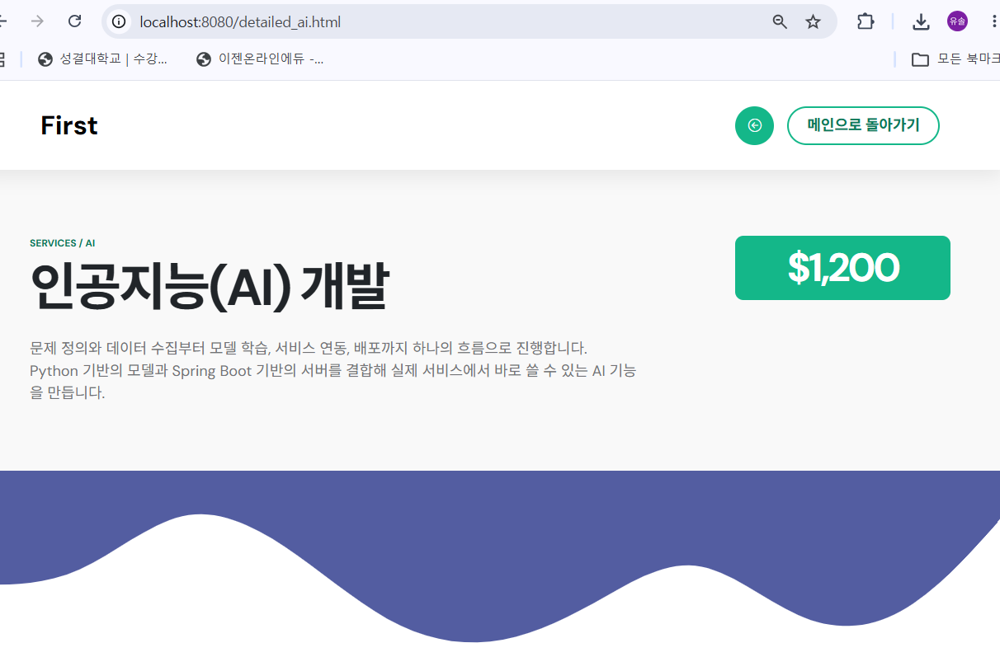
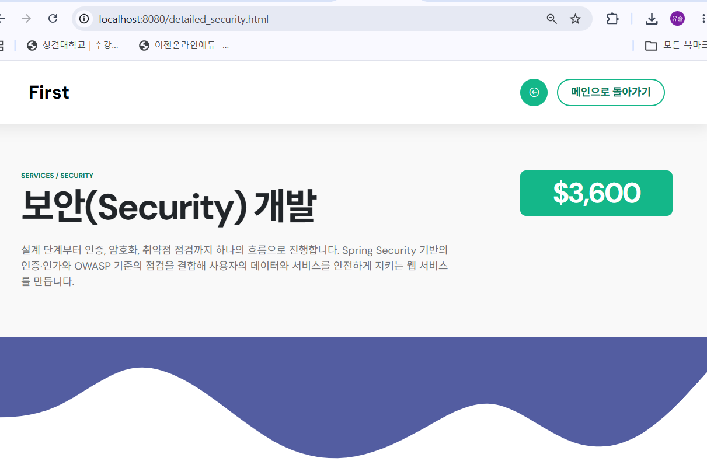
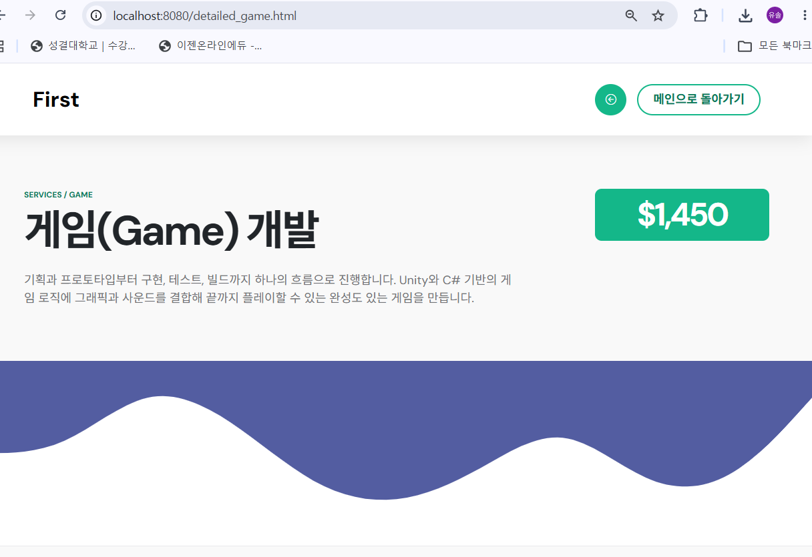
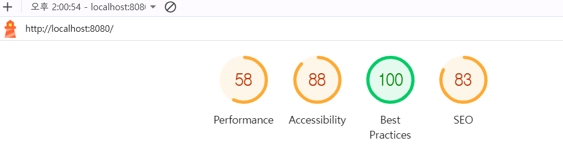
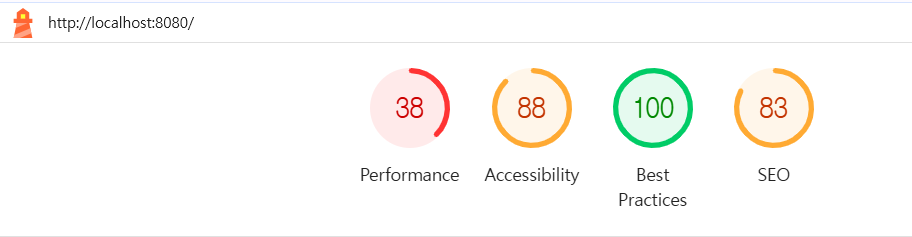

## 0주차 | 대표 내용 틀

### 실행 내용

### 학습 기록

### 연습문제 

## 2주차 | 스프링 부트 개발환경, 테스트 완료

### 실행 내용
1. VSCode에서 스프링 부트 개발 환경 구축
2. 기본 화면 실행 (index.html 실행 및 수정 완료)

### 학습 기록
스프링을 쉽게 사용할 수 있게 해주는 스프링 부트의 기반을 다졌고, 웹 구조화 및 요청 처리 방식을 코드 실습을 통해 익힐 수 있었다.

### 실제 동작 과정
1. 내장 톰캣이 웹페이지를 실행
2. Spring IoC 컨테이너가 자바 객체(빈)들을 관리
3. 서블릿이 프론트 컨트롤러 역할을 수행
4. Thymeleaf가 서버 측에서 HTML을 렌더링하여 응답

### 연습문제 
URL 매핑과 컨트롤러 추가하기 
1. 컨트롤러에 맵핑을 추가 (hello2 메서드)

2. hello.html 링크를 수정하여 hello2.html로 이어지게 만듦 

3. hello2.html을 작성하고, Thymeleaf(`th:text`) 문법을 이용해 컨트롤러에서 전달한 5개 속성 값을 서버 렌더링 시점에 동적으로 출력하도록 구현

컨트롤러에서 뷰로 데이터를 전달하고 렌더링하는 요청 처리 흐름을 직접 실습을 통해 이해할 수 있었음.

## 3주차 | 웹 호스팅 알기, 포트폴리오 작성하기 

### 실행 내용
1. 개인 포트폴리오 화면 추가, 프로필 정보 업데이트 
    - 부트스트랩 5 기반 디자인 
2. 포트폴리오 화면 텍스트 & 아이콘 수정 
3. 포트폴리오 화면 하위 페이지 추가 

### 학습 기록
1. Thymeleaf 문법 익히기 
    - 상대경로 설정들을 절대 경로 또는 thymeleaf로 수정 
2. URL 접근 방식의 차이 알기 (일반 페이지 요청 / 컨트롤러)

### 연습문제 
1. 프로필 수정하기 (하위 페이지 추가)
    - detailed_ai.html과 detailed_game.html, detailed_security.html을 추가로 삽입하여 하위 페이지를 늘렸다. 

2. 성능 확인(원인 분석)
    - Lighthouse 성능 분석을 통해 Pc/모바일에서의 결과를 비교해 보았다.
    - PC/모바일 모두 가장 성능을 감소시킨 항목은 Performance였고, 두 번째로 감소시킨 항목은 SEO였다. 
    - PC 
        
    - 모바일 
        
    - 둘의 성능에 차이가 나는 이유는 모바일 테스트는 느린 4G 및 CPU감속이 걸렸기 때문이고, 데스크탑은 그렇지 않았기 때문으로 비춰진다. 
